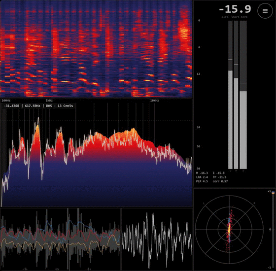

# minimeters-bridge

Real-time audio metering for a Spotify ([Spicetify](https://spicetify.app)) visualizer.
It captures the system output — the same source as MiniMeters' *Default Output Capture* —
computes broadcast-grade measurements and streams them over a local WebSocket
(`ws://127.0.0.1:8985`) so a Spicetify custom app can draw them.

Windows and macOS (and Linux) are supported. On Windows it uses the WASAPI loopback of the
default output device; on macOS/Linux it reads an input device that carries the system
output (see [Capture setup](#capture-setup)).



Because it reads the **actual audio** (not Spotify's precomputed analysis), the numbers are
real: a −20 dBFS tone reads −20.00 LUFS / −19.99 dBTP, matching MiniMeters.

## Install (Windows)

1. On this page, click the green **Code** button, then **Download ZIP**.
2. Right-click the ZIP and choose **Extract All**.
3. Open the extracted folder and double-click **`Install MiniMeters Bridge.bat`**.

That's it. No administrator rights are needed. If Python 3.12 is missing it is installed
automatically **for your user only** (via winget; your existing Python is left untouched).
Everything is placed under `%LOCALAPPDATA%\MiniMetersBridge`, and the bridge starts about
30 seconds after each logon, listening **only on `127.0.0.1`** (localhost). A console window
shows plain-English progress and stays open so you can read the result — it ends with
`MiniMeters bridge is running on ws://127.0.0.1:8985`.

To remove everything later, double-click **`Uninstall MiniMeters Bridge.bat`**.

> The install scripts are short, readable, and MIT-licensed; the bridge binds only to
> localhost (nothing internet-facing). Because they are unsigned, Windows SmartScreen may
> show an "unknown publisher" note the first time.

After it's running, finish the Spotify side by following [`visualizer/README.md`](visualizer/).

<details>
<summary>Prefer the command line?</summary>

One-liner (downloads and runs the same `install.ps1` you can read in this repo):

```powershell
irm https://raw.githubusercontent.com/Manuel-1312/minimeters-bridge/main/get.ps1 | iex
```

Manual / developer path:

```powershell
pip install -r requirements.txt
python bridge.py          # foreground, logs to bridge.log
python test_client.py 3   # read 3 s of frames
powershell -ExecutionPolicy Bypass -File install.ps1   # register the logon task
```

</details>

## Install (macOS / Linux)

Python 3.12+:

    pip install -r requirements.txt

numpy, scipy and websockets everywhere, plus the platform's capture backend:
pyaudiowpatch + pycaw + comtypes on Windows, [sounddevice](https://python-sounddevice.readthedocs.io)
(PortAudio) on macOS/Linux. `requirements.txt` picks the right ones by platform marker.

### Capture setup

**macOS** — macOS has no native loopback, so you need a virtual audio driver and you have to
send the output to it:

1. Install one, e.g. [BlackHole](https://existential.audio/blackhole/):

       brew install --cask blackhole-2ch

2. Open *Audio MIDI Setup* → **+** → *Create Multi-Output Device*, and tick both your real
   output (speakers/headphones) and *BlackHole 2ch*. Select that Multi-Output Device as the
   system output, so you keep hearing the audio while BlackHole receives a copy.
   Tip: in a Multi-Output Device, set your real output as the **Primary** device (the
   *Master Device* column) and tick *Drift Correction* on the others.
3. The first run asks for microphone permission (macOS gates every input device, virtual
   ones included). Grant it to the app that launches the bridge — Terminal, iTerm…;
   otherwise the capture opens fine but reads pure silence.

With a Multi-Output Device the macOS volume slider is disabled — use the volume in Spotify,
or set the level on the real output inside *Audio MIDI Setup*. This does not affect the
measurements: BlackHole always receives the signal at full scale.

**Linux** — capture the monitor source of your sink (PulseAudio/PipeWire). If a
`Monitor of…` device shows up in `--list-devices` it is picked automatically; otherwise point
the `pulse` device at the monitor:

    PULSE_SOURCE="$(pactl get-default-sink).monitor" python bridge.py -d pulse

The device is auto-detected among the known loopback drivers (BlackHole, Loopback,
Soundflower, Background Music, VB-Cable, PulseAudio monitors). Override it by name or index
if the guess is wrong:

    python bridge.py --list-devices      # lists the available input devices
    python bridge.py -d "BlackHole 2ch"  # by name (substring) or index
    MINIMETERS_DEVICE="BlackHole 2ch" python bridge.py   # same, via the environment

### Run

    python bridge.py            # logs to bridge.log
    python test_client.py 3     # reads 3 s of frames and prints a summary

If the meters sit at −120 LUFS with the music playing, the bridge is capturing a silent
device: check the setup above (`bridge.log` records which device it opened).

Auto-start (optional, macOS): a `launchd` agent in `~/Library/LaunchAgents/` with
`RunAtLoad` and `KeepAlive` running `python3 /path/to/bridge.py` (`launchctl load` it once).

## What it computes (60 fps by default, ~9 KB/frame)
- **Spectrum** — FFT 8192 (Hann) on the Mid channel → 512-bin Mel spectrum (20 Hz–20 kHz),
  dominant peak with parabolic interpolation.
- **Loudness** — EBU R128 / ITU-R BS.1770: momentary (400 ms), short-term (3 s),
  integrated with gating (−70 abs / −10 rel), LRA.
- **True peak** L/R (4× oversampling), sample peak, total and per-band correlation
  (low < 250 Hz, mid 250–4000, high > 4 kHz).
- **Oscilloscope** — pitch-triggered (autocorrelation), f0 + confidence.
- **Vectorscope** — 192 (L, R) pairs per band.
- On Windows, undoes the endpoint master volume (the loopback arrives post-volume). On
  macOS/Linux there is nothing to undo: what reaches the virtual device is already
  pre-volume, so the readings are independent of the slider either way.

The frame rate is the `FPS` constant in `bridge.py` (60 by default; 30 is plenty if you
want less CPU) — it uses roughly 10–20 % of one core. The `reset` WebSocket message resets
integrated LUFS, and the bridge reopens itself automatically if the default output device
changes (Windows) or the capture stream stops (macOS/Linux).

## Frame layout
See the docstring at the top of `bridge.py` — Float32 little-endian: a 32-value header,
then 512 Mel bins, 512 oscilloscope samples and a 3×192×2 vectorscope block.

## The visualizer (frontend)

This repo is just the audio **bridge** (the backend). The on-screen meters are **RealMeters**,
a separate Spicetify frontend:

- **One click:** install **RealMeters** from the Spicetify Marketplace (Extensions tab), then
  open it from the button in the now-playing bar.
- Source: [Manuel-1312/realmeters-spotify](https://github.com/Manuel-1312/realmeters-spotify)
  (also available there as a custom app with a dedicated sidebar page).

RealMeters needs this bridge running for data. The renderer began as one for
**[Konsl's spicetify-visualizer](https://github.com/Konsl/spicetify-visualizer)** (MIT); a
copy of that renderer is kept in [`visualizer/`](visualizer/) for reference.

## License
MIT — see [LICENSE](LICENSE).
